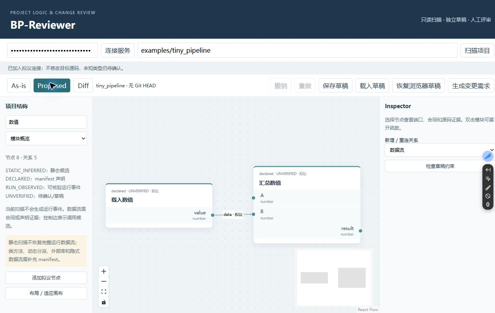

# BP-Reviewer

Blueprint-based Project Reviewer：只读分析本地 Python 项目，以证据图和拟议草稿整理可审阅的变更需求。

适用于普通 Python 项目与科研代码库。React Flow 画布展示模块、顶层函数、静态导入/调用、中文端口说明和源码证据；可选 manifest 声明自动扫描无法确认的数据流。可展开模块、缩放、选择节点、检查类型/合同和源码哈希。

独立工具；不运行目标代码、不训练模型、不自动修改目标源码。静态扫描无法完整还原运行数据流，详情见 [manifest 与证据边界](docs/manifest.md)。本次在既有私有仓库准备代码，等待用户批准首次远程推送。许可证评估见 [docs/licensing.md](docs/licensing.md)。

## Install and start

Windows PowerShell + Conda，独立环境名 `bpreviewer`。Node `24.15.0`、npm `11.16.0`，不要求科研环境。

```powershell
conda env create -f environment.yml
conda activate bpreviewer
python -m bpreviewer.cli --allow-root ./examples/tiny_pipeline --allow-root ../AstroLCA
```

将终端输出的本地令牌输入页面。可用环境变量 `BPREVIEWER_TOKEN` 指定令牌；不要提交令牌。每次自动生成的令牌仅在当前进程有效。`--allow-root` 可重复，只允许读取显式授权目录；状态默认在当前目录 `state/`，可通过 `--state` 改到其他独立目录，不能设在目标项目中。服务固定绑定 loopback 的 8011 端口。

另开终端（前端无需激活科研环境）：

```powershell
cd frontend
npm ci
npm run dev
```

打开 `http://127.0.0.1:5174`，连接服务后输入/选择项目路径，再扫描。无权读取或不存在的路径会报错。AstroLCA 仅作为外部只读目录，不需要安装它；省略第二个 `--allow-root` 也可只运行合成示例。开发代理到 8011；自行改后端端口时须同步代理。此流程面向本地，不是公网部署配置。

## Review a proposed change

1. As-is 是只读证据基线。双击模块或用层级下拉框展开函数；点击证据按钮检查源码及过期状态。
2. 切换 Proposed，添加/删除节点、编辑端口 JSON 与参数。支持多输入/输出、拖线、点击输出后点击输入、断开和重连；撤销/重做、保存/载入草稿及浏览器恢复按快照隔离。
3. 在合成示例中，将载入数值的 `value` 输出从汇总输入 `A` 重连到 `B`。未知类型显示“待确认”；明确合同检查类型、Schema、方向、必填、基数、语义及声明的 DAG 约束。
4. 点击生成变更需求，Diff 中导出 JSON 和 Markdown。重连分别记录删除旧边、添加新边；输出包含基线 Git HEAD、证据、前后端口、影响节点和人工审批项。布局变化不计入代码需求。

不存在自动代码写回、全图执行或科研 Run 功能。控制依赖与数据流分别显示。新关系不会被当作现有项目事实。

## Extend and validate

从 [合成 manifest](examples/tiny_pipeline/bpreviewer.manifest.json) 起步，使用 [通用 schema](docs/manifest.schema.json) 定义业务模块、端口、合同与数据流。项目专有 profile/快照放本地 `state/`，不要把商业数据和机器路径提交到本仓库。添加适配器也必须只读，提供真实证据并遵守扫描边界。

```powershell
conda activate bpreviewer
python -m pytest -q
python -m ruff check backend tests scripts
python -m ruff format --check backend tests scripts
python scripts/acceptance.py --project ../AstroLCA
cd frontend
npm test
npm run build
```

[后端职责](backend/README.md)、[前端说明](frontend/README.md)、[测试覆盖](tests/README.md)。贡献时同步受影响目录 README，添加有意义的合成测试；不要引入对目标包的 import、自动执行、密钥或科研资产。依赖版本和来源在锁文件及 [许可评估](docs/licensing.md) 中记录。

实际浏览器验收截图见 [截图说明](docs/screenshots/README.md)：合成示例的 A→B 重连、语义 Diff 和源码证据。已验证真实拖线、断开、重连、撤销/重做、保存后刷新恢复及 JSON/Markdown 下载；这些操作不修改目标源码。


